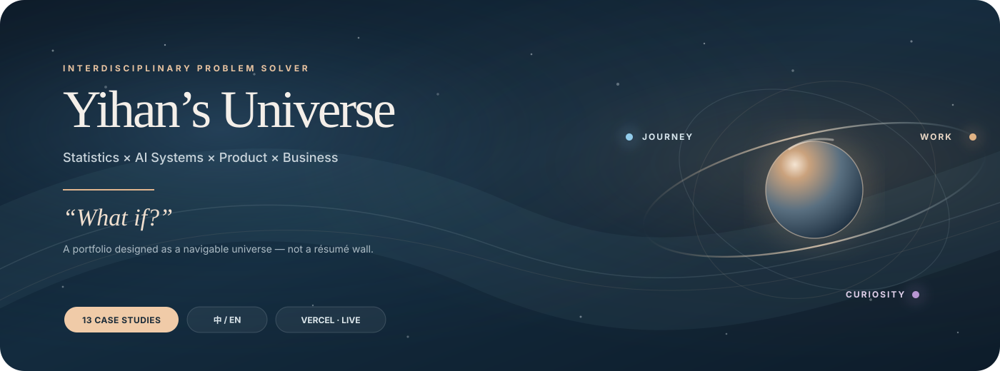
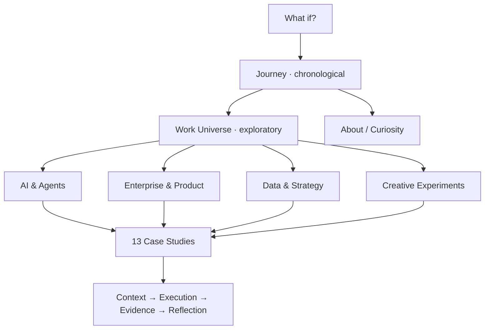

<p align="center">
  
</p>

<div align="center">

<a href="https://yihanuniverse.vercel.app"></a>
<a href="https://yihanuniverse.vercel.app/zh"></a>
<a href="https://yihanuniverse.vercel.app/en"></a>


</div>

<br />

> **A portfolio should show more than the polished ending.**  
> It should make the problem, the reasoning, the evidence, and the boundary visible.

# Yihan’s Universe

**Yihan’s Universe** is my bilingual interactive portfolio — built around the idea that a career is not one straight line, and good work is easier to understand when people can actually explore it.

Instead of turning the homepage into a résumé wall, the site separates two different stories:

- **Journey** → what happened chronologically: UBC → 冷酸灵 → Accenture → BAYESTONE.
- **Work Universe** → what I chose to build, test, analyze, or explore across AI systems, product, data, and creative experiments.

The result is a portfolio that behaves more like a **navigable universe** than a list of cards.

---

## 01 — Start here

| | |
|---|---|
| **Live portfolio** | **[yihanuniverse.vercel.app ↗](https://yihanuniverse.vercel.app)** |
| **中文** | [Enter the Chinese experience ↗](https://yihanuniverse.vercel.app/zh) |
| **English** | [Enter the English experience ↗](https://yihanuniverse.vercel.app/en) |
| **Work Universe** | [Jump directly to the project constellation ↗](https://yihanuniverse.vercel.app/zh#work) |
| **Current release** | **R16 · Interactive Portfolio** |

---

## 02 — Explore the constellation

<table>
<tr>
<td valign="top" width="25%">

### ✦ AI & Agents
**3 projects**

- [AgentLab](https://yihanuniverse.vercel.app/zh/work/agentlab)
- [LLM Benchmark](https://yihanuniverse.vercel.app/zh/work/benchmark)
- [Content Review Copilot](https://yihanuniverse.vercel.app/zh/work/content-qa)

<sub>Model evaluation · Agent reliability · Content quality</sub>

</td>
<td valign="top" width="25%">

### ✦ Enterprise & Product
**4 projects**

- [Requirement Alignment Engine](https://yihanuniverse.vercel.app/zh/work/requirement)
- [Task Summary Workflow](https://yihanuniverse.vercel.app/zh/work/task-summary)
- [SIT / Defect Dashboard](https://yihanuniverse.vercel.app/zh/work/dashboard)
- [Training Material Generator](https://yihanuniverse.vercel.app/zh/work/training)

<sub>Requirements · Systems · Enterprise workflows</sub>

</td>
<td valign="top" width="25%">

### ✦ Data & Strategy
**4 projects**

- [Airbnb Price Analysis](https://yihanuniverse.vercel.app/zh/work/airbnb)
- [S&P 500 Excess Returns](https://yihanuniverse.vercel.app/zh/work/sp500)
- [Player Retention Analysis](https://yihanuniverse.vercel.app/zh/work/minecraft)
- [Deloitte Digital Camp](https://yihanuniverse.vercel.app/zh/work/deloitte)

<sub>Statistics · Modeling · Decision support</sub>

</td>
<td valign="top" width="25%">

### ✦ Creative Experiments
**2 projects**

- [Character Genesis](https://yihanuniverse.vercel.app/zh/work/character)
- [Life RPG](https://yihanuniverse.vercel.app/zh/work/liferpg)

<sub>Interactive storytelling · Personal systems</sub>

</td>
</tr>
</table>

---

## 03 — Not just screenshots

The portfolio uses three different evidence modes on purpose:

| Mode | What HR / reviewers can do | Boundary |
|---|---|---|
| **Live product** | Open an actual deployed project and interact with it | Availability depends on the linked deployment |
| **Portfolio-native interactive preview** | Click through a workflow, filter data, inspect test cases, or simulate decisions directly inside the case study | Uses synthetic / demo data unless explicitly stated otherwise |
| **Documented evidence** | Read verified project facts, results, methodology, and limitations | No invented ROI, adoption, model score, or production claim |

### A few hands-on paths

- **[AgentLab →](https://yihanuniverse.vercel.app/zh/work/agentlab)** Run → Diagnose → Patch → Regression.
- **[LLM Benchmark →](https://yihanuniverse.vercel.app/zh/work/benchmark)** Explore how test cases and evaluation rubrics are designed.
- **[Requirement Alignment Engine →](https://yihanuniverse.vercel.app/zh/work/requirement)** Walk through ambiguous requirement → confirmed scope.
- **[Content Review Copilot →](https://yihanuniverse.vercel.app/zh/work/content-qa)** Try a browser-side review example with explicit demo boundaries.
- **[Life RPG →](https://yihanuniverse.vercel.app/zh/work/liferpg)** Experience the task / XP feedback loop.

---

## 04 — Information architecture



**Journey and Work intentionally stay separate.**  
Journey answers _“How did I get here?”_ while Work answers _“What kinds of problems do I choose to explore?”_

---

## 05 — Visual language

The design system follows **Experimental Tech Editorial × Cinematic Galaxy**.

| Layer | Direction |
|---|---|
| **Base** | Midnight mist · warm graphite |
| **Text** | Warm ivory |
| **Accent** | Champagne light |
| **Motion** | Slow orbit, signal paths, spatial depth |
| **Typography** | Editorial hierarchy rather than dashboard density |
| **Interaction** | Travel through Journey; explore / focus inside Work |

The goal is not “space UI for the sake of space UI.”  
The universe metaphor carries the information architecture: **one path for lived experience, multiple orbits for independent work.**

---

## 06 — Under the hood

This repository intentionally stays lightweight.

```text
yihan.universe/
├── index.html                 # application shell
├── app.js                     # routing + page interactions
├── data.js                    # portfolio content
├── v03-markup.js              # home / Journey / Work markup
├── r5-case-studies.*          # case-study system
├── r14-*                      # linked case + galaxy system
├── r15-galaxy-redesign.css    # Work Universe visual language
├── r16-case-layout-fix.css    # current case-study layout override
├── assets/                    # project art + portfolio visuals
├── docs/                      # QA / archive notes
├── serve.py                   # local route-aware preview server
└── vercel.json                # bilingual route rewrites
```

**Stack**

```text
HTML · CSS · JavaScript · SVG · lightweight WebGL helpers
Vercel · GitHub
```

There is **no framework build step** for the portfolio shell. Vercel serves the static application and rewrites bilingual routes back to `index.html`.

---

## 07 — Run locally

Clone the repository and start the route-aware preview server:

```bash
python serve.py
```

On some Windows machines:

```bash
py serve.py
```

Then open:

```text
中文      http://127.0.0.1:4184/zh
English   http://127.0.0.1:4184/en
```

Do not use `file://` / double-click `index.html` for QA — the portfolio uses route rewrites for direct project URLs.

---

## 08 — Routes worth testing

```text
/zh
/en

/zh/journey/ubc
/zh/journey/lengsuanling
/zh/journey/accenture
/zh/journey/bayestone

/zh/work/agentlab
/zh/work/benchmark
/zh/work/requirement
/zh/work/task-summary
/zh/work/dashboard
/zh/work/training
/zh/work/content-qa
/zh/work/airbnb
/zh/work/sp500
/zh/work/minecraft
/zh/work/deloitte
/zh/work/character
/zh/work/liferpg

/zh/life
/zh/resume
```

All of the above have corresponding `/en/...` routes.

---

## 09 — Truth layer

> [!IMPORTANT]
> This portfolio is designed to be visually expressive **without blurring what is verified and what is illustrative**.

- Interactive enterprise examples use **synthetic or anonymized data** and do not connect to employer systems.
- BAYESTONE Benchmark: **74 secondary capabilities / 148 implemented test sets** refers to test-set construction; it does **not** claim every model or evaluation round is complete.
- AgentLab controlled results are presented as controlled regression evidence, not universal production-model improvement.
- Content Review interactive examples clearly distinguish browser/demo behavior from real compliance decisions.
- No unverified ROI, efficiency uplift, long-term adoption, or production deployment claim is added for internship projects.
- Corporate concept art is illustrative unless explicitly identified otherwise.

That boundary is part of the product design, not a footnote.

---

<details>
<summary><strong>Repository history & canonical source</strong></summary>

<br />

The production repository is:

**[ychen393/yihan.universe](https://github.com/ychen393/yihan.universe)**

The similarly named `ychen393/Yihan-Universe` is an older development/archive source and should not be used for future production pushes.

Historical recovery information remains in:

- [Version Archive](docs/VERSION_ARCHIVE.md)
- [Production backup branch](https://github.com/ychen393/yihan.universe/tree/backup/production-before-v03-2026-10-12)

</details>

<details>
<summary><strong>QA note</strong></summary>

<br />

The current portfolio includes desktop and responsive rules, direct-route rewrites, reduced-motion handling, and interactive case previews.

A successful Vercel build means the deployment is available; it does **not** automatically prove every viewport, animation, external demo, or browser interaction has been visually inspected. Final public releases should still be checked in a real browser at representative desktop and mobile widths.

</details>

---

<div align="center">

### What if?

很多事情，都是从一句「要不试试」开始的。

**[Enter Yihan’s Universe ↗](https://yihanuniverse.vercel.app)**

</div>
